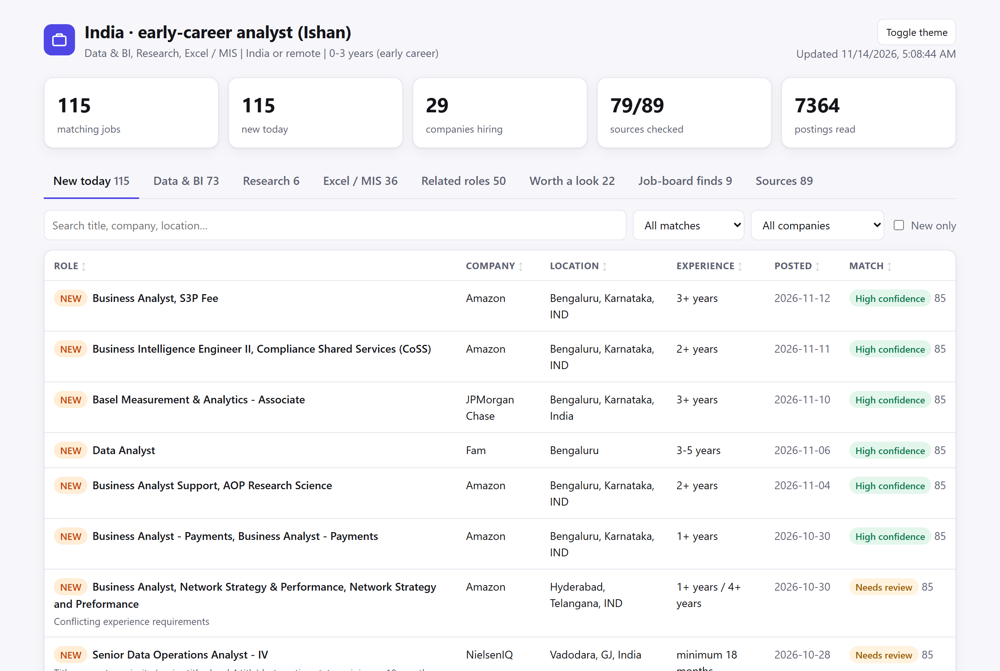
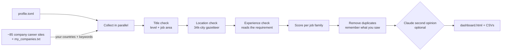

<div align="center">

# JobFleet

**Your own daily job list, straight from company career sites. Free, open source, and set up in a few minutes.**

Tell it *where* you want to work, *how experienced* you are and *which kinds of jobs* you want.<br>
Every day it reads thousands of openings on company career sites, keeps the ones that really fit, and shows them on one page.

[**Live demo**](https://ishanthakur526-droid.github.io/jobfleet/) ·
[Start in 3 minutes](#start-in-3-minutes) ·
[Make it yours](#make-it-yours) ·
[How it works](docs/HOW_IT_WORKS.md) ·
[FAQ](docs/FAQ.md)



</div>

## Why JobFleet

Job boards show you everything at once: senior roles when you are starting out, jobs in the wrong country, the same posting five times, ads. JobFleet goes to the source, the career sites of the companies themselves, and applies your rules the same way every day:

- **Right place.** Any country, optionally only certain cities, with or without remote jobs. It knows 34,000 cities, so "Indianapolis" is never India and "San Jose, CA" is California.
- **Right level.** It reads what a posting actually asks for ("2-4 years", "minimum 5 years", "freshers welcome") and ignores company history ("over 45 years of excellence"). Titles above your level (Director, Principal, Head of...) are filtered out.
- **Right roles.** Pick from 21 ready-made job families (software, data, marketing, finance, design, HR, sales...) or write your own list of titles.
- **Nothing twice.** It remembers what you have seen and marks today's new jobs. The same role posted five times shows up once.
- **Free.** No accounts, no API keys, no subscriptions. Optional AI features use the Claude subscription you may already have.

## Start in 3 minutes

Pick one of two ways.

### A. No installation: let GitHub run it for you

Best if you do not want to install anything. GitHub runs JobFleet every weekday for free and publishes your results as a web page. The page is public, like the repository (it shows job postings and your search settings, nothing else); see [privacy in cloud mode](docs/CLOUD.md#privacy).

1. Sign in to GitHub (a free account is fine) and click **[Use this template](https://github.com/ishanthakur526-droid/jobfleet/generate)** → **Create repository**.
2. In your new repository, open **Settings → Pages** and set **Source** to **GitHub Actions**.
3. Open **Actions → Set up my profile → Run workflow**, fill in the form (country, years of experience, job families) and press **Run workflow**.
4. About five minutes later your dashboard is live at `https://<your-username>.github.io/<repository-name>/` and updates every weekday.

Step-by-step with pictures: [docs/CLOUD.md](docs/CLOUD.md).

### B. On your own computer

**Windows**

1. [Download the ZIP](https://github.com/ishanthakur526-droid/jobfleet/archive/refs/heads/main.zip) and unzip it (or `git clone` it).
2. Double-click **`Setup.bat`**. It installs everything into the folder (it offers to install Python if you do not have it) and asks six short questions.
3. Double-click **`Run.bat`**. After 2-4 minutes your dashboard opens in the browser.

**macOS / Linux**

```bash
git clone https://github.com/ishanthakur526-droid/jobfleet.git && cd jobfleet
./setup.sh      # installs into .venv and asks six short questions
./run.sh        # finds jobs; open outputs/dashboard.html
```

To run it automatically every weekday: `jobfleet schedule` (Windows Task Scheduler; on macOS/Linux it prints the cron line to add). Something not working? `jobfleet doctor` checks everything and says what to fix.

## Make it yours

Everything about *your* search lives in one file, **`profile.toml`**. The setup wizard writes it for you, and you can open it in Notepad at any time. It has three parts:

```toml
[location]                       # WHERE
countries = ["United States", "Canada"]
cities    = ["Seattle", "Vancouver"]   # optional; leave [] for the whole country
remote    = "include"            # include | only | exclude

[experience]                     # LEVEL
min_years = 2
max_years = 6
level     = "mid"                # student | early_career | mid | senior | leadership

[[role_family]]                  # WHAT (one block per kind of job; add as many as you like)
name   = "Data Engineering"
titles = ["Data Engineer", "Analytics Engineer", "ETL Developer"]
keywords = ["sql", "python", "spark", "airflow", "dbt"]
```

| You want to... | Do this |
| --- | --- |
| Start over or switch careers | Run `Setup.bat` / `jobfleet setup` again (your old profile is backed up). |
| Describe it in plain words | `jobfleet setup --describe "junior frontend developer in Berlin, open to remote"` (uses Claude, optional). |
| Use a ready-made example | Copy one from [`profiles/`](profiles/) over `profile.toml`: US software engineer, UK marketing, Germany data scientist, Singapore finance, Canada customer success, remote product manager, India fresher developer, India analyst. |
| Add another kind of job | Copy a `[[role_family]]` block and change its name and titles. Each family gets its own tab and CSV file. |
| Add a job title | Add it to `titles`. Word order does not matter: "Analyst, Data" matches "Data Analyst". |
| Search more companies | Paste career-page links into **`my_companies.txt`**, one per line, or run `jobfleet add-company https://company.com/careers` to find and check the job board behind a careers page. |
| Fine-tune seniority | `[advanced]` → `exclude_levels = ["lead"]`, `allow_levels = ["manager"]` and more: see [docs/CUSTOMIZE.md](docs/CUSTOMIZE.md). |

The full guide, with every option explained in plain language: **[docs/CUSTOMIZE.md](docs/CUSTOMIZE.md)**.

## What you get

After each run, `outputs/` holds:

| File | What it is |
| --- | --- |
| **`dashboard.html`** | **Start here.** All lists on one page: a tab per job family, *New today*, *Worth a look* (borderline matches), *Sources* (what was checked). Search, filter by company or confidence, sort, light/dark. Works offline. |
| `<family>_jobs_today.csv` | Each family's list for Excel / Google Sheets: company, title, experience, link, notes, location, posted date, first seen, confidence. |
| `new_only_<family>_jobs_today.csv` | Only the jobs first seen today. |
| `reports/daily_summary_latest.md` | Counts, any sources that failed, and today's new jobs with links. |
| `overflow/`, `quality_tiers/`, `audit/` | Everything else, so nothing is silently dropped: jobs beyond the per-list caps, borderline matches, and every rejected job with the reason. |

Each job is labelled **High confidence** (clear title match plus evidence) or **Needs review** (for example a "Senior Analyst" title kept because the posting asks for only 2 years). Lists hold the best 40 per family, at most 8 per company; the rest go to `overflow/`.

## Where the jobs come from

JobFleet reads the public job feeds that company career sites are built on, the same data their own career pages show:

| Platform | Examples of companies using it |
| --- | --- |
| Workday | Citi, Mastercard, Nasdaq, Salesforce, Target, Genpact, Gartner |
| Oracle Recruiting Cloud | JPMorgan Chase |
| Greenhouse, Lever, Ashby, SmartRecruiters | Stripe, Okta, Bosch, many startups |
| Company-specific | Amazon, Microsoft, Accenture, Capgemini, TCS, EY, Deloitte, Cognizant |
| Any page with schema.org job data | many company career pages |

About 85 companies are included (`config/companies.json`); add your own in `my_companies.txt`. Each source is asked only for your countries and keywords where it supports that. LinkedIn's public search is available but **off by default** (automated access is against LinkedIn's terms; `--include-linkedin` to opt in). Sites that require solving a CAPTCHA are not supported.

> **Coverage note.** Results depend on which companies are in the list. The included list leans toward technology, finance and consulting employers. For other fields, add the companies you care about to `my_companies.txt`, or turn on the weekly Claude company scout, which searches for more.

## Optional: AI features with Claude

If you have the [Claude Code](https://claude.com/claude-code) CLI and a Claude subscription, JobFleet uses it (no API key, no extra cost) for:

- **A second opinion on borderline jobs** (daily): Claude reads only the jobs the rules were unsure about and can promote or demote them. It runs with all tools disabled, and job text is treated as untrusted.
- **A company scout** (weekly): Claude searches the web for employers hiring for your profile. Every job board it suggests is opened and checked by the normal rules before it is added.
- **Setup from a sentence:** `jobfleet setup --describe "..."`.

Everything works without Claude. Turn it off with `enabled = false` under `[ai]` in `profile.toml`.

## How it works



The details, including the rules for seniority, location and experience: [docs/HOW_IT_WORKS.md](docs/HOW_IT_WORKS.md).

## How it was built with AI

JobFleet started as a personal script to find early-career analyst jobs in India. It was rebuilt in three passes with **Claude Code** as the engineering partner, under a strict zero-budget rule (open-source tools and a Claude subscription only):

1. **Audit (v3).** Claude read the old code against its own output: a 709-row job history and a 10,775-row log of rejected jobs. It found 15 confirmed defects, each with evidence. For example, every Amazon link returned "page not found", "Indiana" counted as India, and "over 45 years of excellence" rejected a junior job. Each fix has a regression test ([CHANGELOG](CHANGELOG.md)).
2. **Precision (v3.0.1).** The first live AI runs were reviewed by hand: Claude's company scout had guessed 4 of 8 job-board addresses, so it now has to open every address it returns, and borderline demotions need 85% confidence.
3. **Make it anyone's (v4).** The India/analyst assumptions, hardcoded in about 12 places, became one `profile.toml`, a worldwide location engine, a setup wizard, a dashboard and a no-install cloud mode. Each step was checked against real data. Replaying a saved day of 7,519 job postings through the new engine gave the same decision for every one of them as the old engine did, and live runs for India, the US and the UK were reviewed row by row.

The human set the goals and rules, approved every plan, and reviewed the results. The AI did the analysis, the code, the tests and the verification runs.

## For developers

```bash
uv sync                                  # Python 3.11+, locked dependencies
uv run pytest -q                         # offline test suite
uv run ruff check src tests scripts
uv run jobfleet run --replay outputs/raw/<run>.jsonl.gz --output-dir outputs_replay   # re-classify a saved run offline
uv run python scripts/compare_runs.py outputs/raw/<run>.jsonl.gz --save before        # then --against before after a change
uv run python scripts/smoke_sources.py   # live: one company per source type
```

- Code map: `cli.py` (commands), `profile.py` and `levels.py` (your rules), `classifier.py`, `geo.py` (worldwide locations), `experience.py`, `sources/` (one module per platform), `pipeline.py`, `state.py` (SQLite history), `dashboard.py`, `setup_wizard.py`, `role_library.py`.
- Adding a source: [docs/ADD_A_SOURCE.md](docs/ADD_A_SOURCE.md). Contributions welcome: [CONTRIBUTING.md](CONTRIBUTING.md).
- CI runs the tests on Windows and Linux and a secret scan (gitleaks) on every push.

## Privacy and security

- Your profile, history and results stay on your computer (or in your own GitHub repository in cloud mode). Nothing is sent anywhere except normal requests to company career sites.
- No passwords or API keys are stored. Claude uses its own CLI login; optional search keys are read from environment variables and removed from logs.
- See [SECURITY.md](SECURITY.md) to report a problem.

## License and credits

[MIT](LICENSE) © Ishan Thakur. Place data from [GeoNames](https://www.geonames.org/) (CC BY 4.0). Job postings belong to the companies that publish them; JobFleet only links to them.
