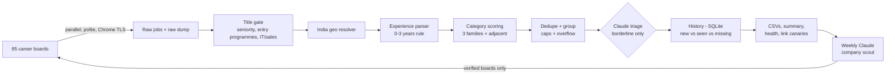

# Job Scraper Fleet

A zero-cost, local pipeline that finds **India-based, early-career (0-3 years)** job openings in three role families and writes clean daily CSVs:

- **Data & BI** - Data/BI/Business/Reporting/Marketing/Operations/Insights Analyst, BI Engineer, Dashboard Developer, Analytics Associate
- **Research** - Research/Market Research/Competitive & Market Intelligence/Consumer Insights/Secondary/Equity Research Analyst
- **Excel / MIS** - MIS, Excel/Sheets, finance/revenue/sales/business operations, reconciliation, KYC, AP/AR, procurement, order management

It reads public career-site APIs (Workday, Oracle Recruiting, SmartRecruiters, Greenhouse, Lever, Ashby, Amazon, Accenture, Capgemini, TCS iBegin, EY, Microsoft and more), applies deterministic India / experience / seniority rules, removes duplicates, remembers what you have already seen, and runs every weekday at 4 PM through Windows Task Scheduler. Claude (through your own Claude Code login, no API billing) is used only where it adds value: a weekly company scout and a daily second opinion on borderline jobs.

> **v3.0.0** fixes 15 confirmed defects in v2 (broken Amazon links, Indiana jobs in India lists, silently dropped jobs, a dead Codex scout, ...). See [CHANGELOG.md](CHANGELOG.md).

## Daily files to check

After the 4 PM run, open `outputs\`:

| File | What it is |
| --- | --- |
| `reports\daily_summary_latest.md` | **Start here.** Counts, failures, and a table of today's new jobs with links (split into *newly posted* and *newly surfaced*). |
| `new_only_data_bi_roles_today.csv`, `new_only_research_roles_today.csv`, `new_only_excel_sheets_roles_today.csv` | Jobs first seen today. |
| `data_bi_roles_today.csv`, `research_roles_today.csv`, `excel_sheets_roles_today.csv` | Today's full lists (best 40 per family, at most 8 per company). |
| `adjacent_roles_today.csv` | Financial Analyst/FP&A, Pricing, Risk, Credit and Content Analyst roles - worth a look, kept out of the main lists. |
| `aggregator_review_today.csv` | Matches from the Jobgether aggregator (real employer is often hidden). |
| `quality_tiers\possible_match_*.csv` | Borderline titles the rules did not accept - occasional false-negative review. |
| `overflow\overflow_*.csv` | Accepted jobs beyond the 40-per-list / 8-per-company caps (nothing is silently dropped). |

Each list keeps the original five columns first (`Company, Exact Role Name, Experience Required, Application Link, System Notes`) and then adds `Location, Posted, First Seen, Tier, Score, Source`. Files are UTF-8 with BOM so Excel shows every character correctly. If a CSV is open in Excel during a run, the new data is written to `*_new.csv` beside it.

`Tier` is `high_confidence` (strong title + evidence), `needs_review` (e.g. a "Senior Analyst" title kept because the posting states 2-5 years, conflicting experience statements, or a location inferred from the description) or `claude_promoted`.

## How a run works



1. **Collect** from every enabled board in parallel (8 workers, at most 3 requests per host, 120 s per board). Workday and SmartRecruiters are filtered to India server-side; detail pages are fetched only for titles that could match.
2. **Title gate**: drops Senior Manager / Lead / Principal / Staff / Director / Head / VP / Chief titles; drops Trainee, Apprentice, Graduate, Campus, Intern and "pass-out batch" programmes; drops engineering, IT/security operations, sales/support, design and similar titles. *Senior* Analyst/Associate/Executive and *Assistant/Associate/Deputy Manager* titles are kept **only** if the posting states a minimum of 3 years or less (tier `needs_review`).
3. **India check**: structured country codes first, then the location text split into segments (any Indian office counts), with word-boundary matching so "Indiana", "Indianapolis" and "Indian Wells" never pass, and guards for look-alikes such as "Delhi, NY" or "Hyderabad, Pakistan". Empty/"2 Locations"/"Remote" locations trigger a detail fetch; only strict phrases in the description ("based in Pune", "Remote - India") can infer India.
4. **Experience**: only numbers phrased as candidate requirements count - company history ("over 45 years of excellence"), ages, contract lengths, internal-mobility rules and "preferred" qualifications are ignored; titles such as "Analyst | 5-7 yrs" are honoured. Ranges overlapping 0-3 (e.g. 2-5 years) pass; a strict minimum of 4+ rejects; conflicting statements go to `needs_review`.
5. **Score** each family with whole-word keyword matching (so "excellent" is not Excel and "mission" is not MIS) and order-independent title matching ("Analyst, Data" = Data Analyst).
6. **De-duplicate** the same role at the same company and city (across sources and multiple requisitions) into one row with the extra links in System Notes.
7. **Claude triage** (optional): new borderline jobs only, one short call, cached per job.
8. **History** in `outputs\state\jobfleet.sqlite`: a job is "new" the first time it is accepted; it is marked missing only when its board worked today and the job was gone.
9. **Write** CSVs, the summary, `health\source_health_latest.csv` and `health\canary_links_latest.csv` (1-2 links per source are opened each run to catch broken link formats).
10. **Weekly company scout** (optional): Claude searches the web for more India-hiring employers; every board it suggests is verified with the production rules before being added to `config\discovered_boards.json`.

## Setup

Requirements: Windows, Python 3.11+ (tested on 3.14), internet access.

```powershell
# one time, from this folder (uv: https://docs.astral.sh/uv/)
uv sync
```

`uv sync` creates `.venv` from the locked dependencies (`beautifulsoup4`, `curl_cffi`, `jsonschema`). Without uv: `python -m pip install -r requirements.txt`. `run_fleet.ps1` uses `.venv` when it exists, otherwise your system Python.

### Claude (optional, free with your Claude subscription)

Claude features use the **Claude Code CLI** with your normal Claude login - there is no API key and no per-token cost; calls count toward your plan's usage limits (about one short call per day plus one longer weekly scout).

```powershell
claude auth login     # once, opens a browser to sign in
claude auth status    # should show "loggedIn": true
.\run_fleet.ps1 -ForceScout   # optional: test the scout right away
```

If the CLI is missing, logged out or out of usage, the run continues without Claude and the summary says why. Settings live in `config\llm.json`; set the environment variable `JOBFLEET_DISABLE_LLM=1` (or pass `-SkipLLM`) to turn Claude off.

## Running it

```powershell
.\run_fleet.ps1                    # normal run (what the scheduler does)
.\run_fleet.ps1 -SkipLLM           # no Claude calls
.\run_fleet.ps1 -ForceScout        # run the weekly company scout now
.\run_fleet.ps1 -IncludeLinkedIn   # also query LinkedIn's public job search (see note below)
.\run_fleet.ps1 -MaxPerCategory 60
```

A typical run takes 2-4 minutes. Every run logs to `outputs\logs\run_<id>.log` and appends one line (with the exit code) to `outputs\logs\scheduler_runs.log`.

**LinkedIn note:** `-IncludeLinkedIn` uses LinkedIn's public, logged-out job search with a small request budget and stops at the first throttling response. Automated access is against LinkedIn's terms of service, which is why it is off by default. Naukri is not supported (it requires solving a CAPTCHA, which this project will not do).

### Schedule

```powershell
.\install_scheduled_task.ps1   # install/update "Job Scraper Fleet v2 - Weekday 4PM"
.\check_scheduled_task.ps1     # last run time and result
.\uninstall_scheduled_task.ps1
```

The task runs Monday-Friday at 4 PM as your user (so it can use your Claude login), starts as soon as possible after a missed start, waits for the network, and fails the task if Python fails (`LastTaskResult` is non-zero).

## Configuration

| File | Purpose |
| --- | --- |
| `config\categories.json` | Role families: `target_roles` (strings or `{"title", "weight", "requires_title_keyword"}`), `title_keywords`, `positive_keywords` (whole-word), title-level `negative_keywords`, `negative_description_phrases`, and the `adjacent` block. |
| `config\boards.json` | Curated boards: `company`, `source`, `token`, optional `options` (e.g. Lever `params`, Workday `max_jobs`/`search_text`, Oracle `keywords`), `enabled`, `aggregator`, `note`. |
| `config\discovered_boards.json` | Boards added by the company scout (local, gitignored). Move good ones into `boards.json` to keep them. |
| `config\llm.json` | Claude settings (model, timeouts, triage thresholds, scout cadence). |
| `config\company_scout_prompt.md`, `company_scout_schema.json` | The scout's instructions and output schema. |

Supported `source` values: `workday`, `oracle_hcm`, `smartrecruiters`, `greenhouse`, `lever`, `ashby`, `amazon_jobs`, `accenture`, `capgemini`, `tcs_ibegin`, `successfactors`, `eightfold`, `paginated_html`, `generic_html` (schema.org JobPosting pages) and `linkedin_guest` (opt-in).

Boards that fail with "hard" errors (404/410/DNS) three runs in a row are **quarantined** for 14 days and listed in the summary; temporary errors never count.

## Development

```powershell
uv sync                                   # includes pytest and ruff
uv run pytest -q                          # 168 offline unit tests
uv run ruff check src tests scripts
uv run python scripts/smoke_sources.py    # live: one board per source + link check
uv run python scripts/check_outputs.py    # sanity-check outputs/ (non-India rows, link formats, duplicates)
```

Every live run saves its raw jobs to `outputs\raw\<run_id>.jsonl.gz` (kept 14 days). Classification changes can be replayed offline, without touching your real history:

```powershell
uv run python -m jobfleet.cli --replay outputs\raw\<run_id>.jsonl.gz --output-dir outputs_replay
uv run python scripts/eval_classifier.py sample outputs\raw\<run_id>.jsonl.gz   # make a labelling sheet
uv run python scripts/eval_classifier.py score outputs\raw\<run_id>.jsonl.gz outputs\eval\labels.csv
```

Code map: `src/jobfleet/cli.py` (orchestration), `sources/` (one module per source family), `classifier.py`, `geo.py`, `experience.py`, `pipeline.py`, `state.py`, `exporters.py`, `reports.py`, `canary.py`, `llm.py`, `scout.py`, `triage.py`.

## Security and privacy

- No credentials are stored in this repository. Claude uses the CLI's own login; optional search keys (`SERPAPI_KEY`, `BRAVE_SEARCH_API_KEY`) are read from environment variables only and redacted from every log line.
- Job descriptions are untrusted input. The daily Claude triage runs with **all tools disabled**; the weekly scout may only use web search/fetch, and everything it suggests is verified deterministically.
- Live outputs, history, logs, raw dumps and evaluation data stay local (`outputs/` is gitignored). CI runs the test suite and a gitleaks secret scan on every push.
