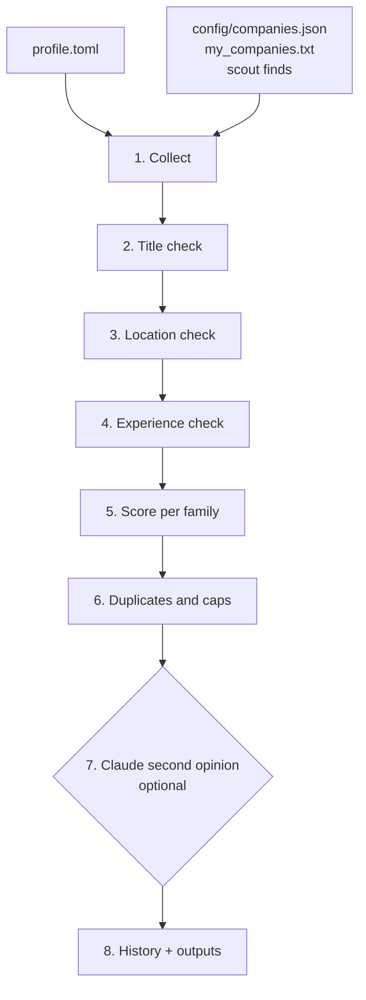

# How JobFleet works

A run has eight steps. All the rules are deterministic, so the same postings and the same `profile.toml` always give the same lists. Claude is an optional extra at the end, never the judge of the hard rules.

## 1. Collect

Every company in the list is read in parallel (8 at a time, at most 3 requests per website, 2 minutes per company). Each platform is asked only for what you need where it can filter: Workday by its country filter (matched by country name), SmartRecruiters and Amazon by country code, Accenture and Capgemini through their country sites, Oracle, Microsoft, EY and LinkedIn by location text. Search-box platforms get your `[search]` keywords. Full job descriptions are only downloaded for titles that could match, which keeps a run to 2-5 minutes.

Requests use a normal browser's network fingerprint, retry only temporary errors (with back-off), and never solve CAPTCHAs. A company whose address stops existing (404/410/DNS) three runs in a row is paused for 14 days; temporary errors never count.

Every run saves the raw postings (`outputs/raw/`, kept 14 days), so rule changes can be replayed offline: `jobfleet run --replay <file>`.

## 2. Title check

Titles are normalised first ("Sr." → senior, "BI" → business intelligence, roman numerals → levels) and then checked against your level preset (see [CUSTOMIZE](CUSTOMIZE.md#2-level-experience)): each seniority word is allowed, dropped, or allowed *only if the posting's stated experience fits* (those rows are labelled *Needs review*). Whole job areas that none of your families covers (engineering, sales, design...) are dropped. A word inside one of your own titles is never held against a job, so "Product Manager" survives when it is what you asked for.

## 3. Location check

Location text is messy: "IND-BLR-Whitefield", "Remote - Indiana", "San Jose, CA", "2 Locations", "1401-G-India: Floor 1 to 12, Hafeezpet Phoenix, Hyderabad". JobFleet:

- uses the platform's own country field when there is one;
- splits multi-location text into parts (a job counts if any part is in your countries);
- scores each part against a gazetteer built from [GeoNames](https://www.geonames.org/) (every country, state and city with 15,000+ people: 34,000 places), plus hand-curated extras (office parks such as "Hitec City", old names such as "Gurgaon", areas such as "Bay Area");
- weighs ambiguous names by population: "Hyderabad" alone is India (78% of people named Hyderabad live there), "Hyderabad, Sindh" is Pakistan, and "Cambridge" alone is too close to call;
- checks state codes against the city: "San Jose, CA" is California but "Toronto, CA" is Canada; "Delhi, NY" is New York;
- matches whole words only, so "Indiana", "Indianapolis" and "Indian Wells" are never India;
- understands regions: "EMEA" is foreign for an India search but undecided for a Germany search.

Only when the location says nothing useful ("Remote", "2 Locations") does it read the description, and then only strict phrases such as "based in Pune" or "remote within the United States". Your `cities` and `remote` settings are applied last.

## 4. Experience check

The parser looks for numbers that are phrased as a requirement for the candidate ("3+ years of experience", "minimum 2 years", "between 1 and 3 years", "Exp: 4-6 yrs" in the title) and ignores:

- company facts: "over 45 years of excellence", "serving clients for 20 years";
- ages, contract lengths, "18 months in current role" (internal mobility);
- *preferred* qualifications, which never reject a job;
- the higher number of alternatives ("5 years, or 3 years with a Master's" → 3).

The result is compared with your range: overlaps are kept, a strict minimum above `max_years` is dropped, and (when `min_years` is above 0) roles that top out below it are dropped as too junior. Conflicting statements keep the job as *Needs review*.

## 5. Score

For each of your role families: a title match is worth 60 points (word order may differ: 50; the family's title keywords alone: 35), and every family keyword found in the description adds 5 (up to 25). Boilerplate is removed first, so "equal opportunity employer" does not count as "equity". **55+** is a match, **75+** with no doubts is *High confidence*. A job matching two families goes to the higher score (ties: `tie_priority`). Near misses with a relevant title word are kept as *Worth a look*.

## 6. Duplicates and caps

The same role at the same company and city (posted twice, or found through two sources) becomes one row with the extra links in its notes. Each list keeps the best 40 rows, at most 8 per company; the rest go to `overflow/` so nothing disappears silently.

## 7. Claude second opinion (optional)

Only jobs the rules were unsure about (*Worth a look*, *Needs review*, related roles) are sent, each at most once, in one call with **all tools disabled**. The prompt is written from your profile. Claude can add a *Worth a look* job to your list when at least 75% sure, or take a *Needs review* job off when at least 85% sure. It cannot overrule the location, experience or title rules, because jobs failing those never reach it.

Weekly, the **company scout** asks Claude to search the web for employers hiring for your profile. It must open every job-board address it returns, and JobFleet then checks each one with the normal rules before adding it.

## 8. History and outputs

History lives in `outputs/state/jobfleet.sqlite`. A job is *new* the first time it is listed; it is marked gone only when its company was read successfully today and the job was missing. Then the dashboard, the CSVs (`<family>.csv` with every current match, `<family>_new.csv`, and `job_history.csv`, the running log of every job ever listed), the daily summary, a source-health report and a few link checks (one or two links per platform are opened to catch broken link formats) are written.
